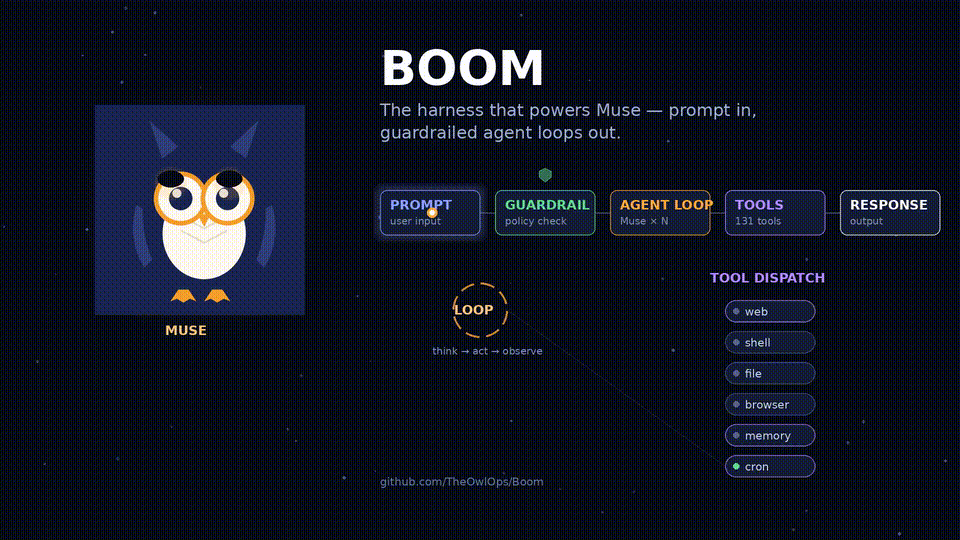

# Boom 🦉

<p align="center">
  <strong>The multi-channel AI agent harness that powers Muse.</strong><br/>
  Prompt in → guardrailed ReAct loops → tools dispatched across 8 channels.
</p>

<p align="center">
  <a href="https://github.com/TheOwlOps/Boom/actions/workflows/ci.yml"></a>
  
  
  
  
</p>

<p align="center">
  
</p>

**Boom** is an autonomous, multi-channel AI agent harness. Chat with it through Telegram, Discord, Slack, Zalo, LINE, WhatsApp, Feishu, or Messenger — or use the desktop or mobile app. It plans, codes, researches, and runs your business operations on its own, with a human in the approval loop for anything risky.

> **Harness, not a model.** Boom orchestrates frontier LLMs (OpenAI, Anthropic, and others) — think OpenClaw, rebuilt for multi-channel business operations.

## ✨ Features

| Category | Highlights |
|----------|------------|
| 🧠 **Brain** | ReAct + DAG + MASS unified planning |
| 💬 **Channels** | 8 platforms: Telegram, Discord, Slack, Zalo, LINE, WhatsApp, Feishu, Messenger |
| 🔍 **DeepSearch** | Multi-hop research with cross-source verification |
| 🤔 **DeepThink** | Multi-perspective analysis, no topic avoidance |
| 🤖 **Dynamic Agents** | Auto-spawn/retire subagents by context (Coder, Researcher, Data Scientist…) |
| 💻 **Autonomous Coding** | Plan → execute → verify → debug loop with AST refactoring |
| 🏢 **Business** | Multi-group management, RBAC, approval flows, auto reports |
| 🎤 **Voice** | STT + TTS voice conversations |
| 🖼️ **Media** | Image generation, OCR (Vietnamese + English), video analysis |
| 📊 **Documents** | Native XLSX (formulas/charts), PPTX, PDF generation |
| 🔌 **Plugins** | Manifest-based, with lifecycle, sandboxing, and dependency resolution |
| 🛡️ **Production** | Circuit breakers, rate limiting, structured logging, graceful shutdown |
| 🖥️ **Clients** | Desktop (Tauri + React) · Mobile (Android PWA) |

## 🚀 Quick Start

Prerequisites: **Python >= 3.11**, plus **Node.js >= 20 + npm** for the desktop app.
The easiest path is Devbox, which provides both reproducibly.

### Setup (all clients)

```bash
git clone https://github.com/TheOwlOps/Boom.git
cd Boom
devbox shell    # reproducible environment (Nix-powered): Python 3.12, Node 22
python3 boom.py setup
```

Without Devbox:

```bash
pip install httpx "pydantic>=2" pyyaml   # must match pyproject.toml dependencies
python3 boom.py setup
```

The setup wizard stores config in `~/.boom/` (override with `BOOM_HOME`) — to
talk to a real LLM and enable channels.

### Desktop (Tauri + React)

```bash
cd apps/desktop
npm install
npm run tauri dev     # Tauri window with hot reload
```

Production installers:

```bash
cd apps/desktop
npm run tauri build   # bundles land in src-tauri/target/release/bundle/
```

The desktop app talks to the Python gateway API (`gateway/api.py`, default
`:18080`), which it spawns automatically on launch. See
[docs/DESKTOP_BUILD.md](docs/DESKTOP_BUILD.md) for system requirements, the
Python-backend sidecar story, and auto-update.

### Mobile (Android PWA)

```bash
cd apps/mobile
python3 -m http.server 8080
```

Open `http://<your-machine-IP>:8080` on the phone (same Wi-Fi as the machine),
then *Add to Home Screen*. Point the app at the gateway by setting `API_BASE`
in `index.html` — full instructions in
[apps/mobile/README.md](apps/mobile/README.md).

### Services

`./start.sh [api|gateway|all|status]` — `all` (the default) starts
everything; `./stop.sh` stops it. Ports can be overridden with
`BOOM_API_PORT` (default 18080) and `BOOM_INGRESS_PORT` (default 8788):

| Service | What | Default port |
|---------|------|--------------|
| API | Python HTTP API (desktop + mobile clients) | 18080 |
| Gateway | Multi-channel daemon (Telegram, Discord, …) | 8788 (ingress) |

## 🛡️ Windows SmartScreen

Boom's Windows installers (`.msi`) are currently **unsigned**, so Windows SmartScreen
may show a blue warning — *"Windows protected your PC"* — with the publisher listed as
**Unknown publisher**.

This warning appears only because the installer has no code-signing certificate; it is
**not** a malware report. Boom is open source: every line of code is public, and anyone
can inspect or build it themselves.

**How to install anyway:**

1. When the blue SmartScreen dialog appears, click **"More info"**.
2. Click **"Run anyway"** to continue the installation.

See [docs/CODE_SIGNING.md](docs/CODE_SIGNING.md) for why the warning appears, how to
verify your download with SHA256 checksums, and the roadmap to signed installers.

## 📖 Documentation

| Doc | Description |
|-----|-------------|
| [docs/TOOLS.md](docs/TOOLS.md) | Full tool catalog (131 tools) |
| [docs/PLUGINS.md](docs/PLUGINS.md) | Plugin system guide |
| [docs/DEEPSEARCH.md](docs/DEEPSEARCH.md) | DeepSearch architecture |
| [docs/CHANNELS.md](docs/CHANNELS.md) | Adding new channels |

## 🏗️ Architecture

```text
┌─────────────┐     ┌──────────────┐     ┌─────────────┐
│  Channels   │────▶│    Brain     │────▶│    Tools    │
│ (8 platforms)│     │ (ReAct+DAG+  │     │ (131 tools) │
└─────────────┘     │  MASS)       │     └─────────────┘
                    └──────────────┘
                           │
                    ┌──────┴──────┐
                    │   Memory    │
                    │ (FTS5+long) │
                    └─────────────┘
```

- **Python** (`agent/`): brain, tools, orchestration, business logic
- **TypeScript** (`apps/desktop/`): React desktop app (Tauri)
- **HTML/JS** (`apps/mobile/`): Android PWA client
- **Rust** (`crates/`): sandbox host

## 🧪 Testing

```bash
# Run all evals
for f in evals/test_*.py; do python3 "$f"; done

# Or with pytest
python3 -m pytest evals/ -q
```

## 🤝 Contributing

1. Fork the repo
2. Create a feature branch (`git checkout -b feat/amazing`)
3. Commit your changes
4. Push and open a Pull Request

See [CONTRIBUTING.md](CONTRIBUTING.md) for the full guide.

## 📄 License

MIT — see [LICENSE](LICENSE).
