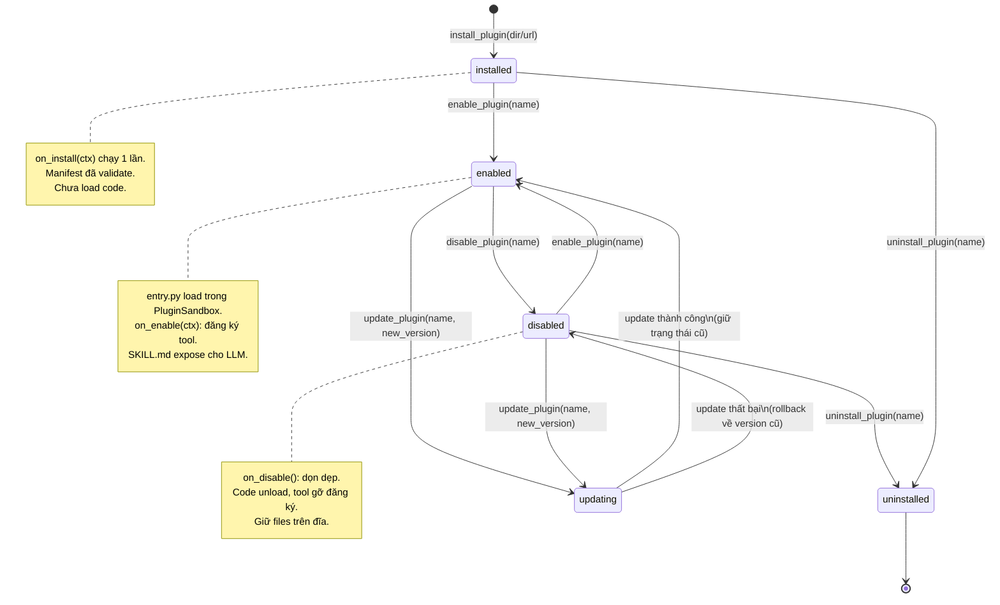

# Hệ Thống Plugin Thống Nhất (Unified Plugin System)

> Design doc — hợp nhất **skills** và **plugins** của Boom thành một kiến trúc duy nhất.
> Chỉ dùng stdlib. Tài liệu tiếng Việt.

## 1. Vấn đề

Hiện tại Boom có 2 hệ thống mở rộng rời rạc, không liên quan gì đến nhau:

| | **Skills** (`skill_loader.py`, `skills_hub.py`) | **Plugins** (`plugin_registry.py`, 41 dòng) |
|---|---|---|
| Đơn vị | Thư mục chứa `SKILL.md` | Thư mục chứa `plugin.json` + `entry.py` |
| Bản chất | Markdown hướng dẫn cho LLM đọc | Code Python thật chạy trong agent |
| Load | Lazy-load qua tool `list_skills` / `view_skill` / `install_skill` | `scan_and_load()` bằng importlib, load hết một lần |
| Quyền | Không chạy code → không cần quyền | Full quyền process agent, không giới hạn |
| Lifecycle | Không có | Không có (chỉ `register(ctx)` một lần) |
| Manifest | Frontmatter YAML trong `SKILL.md` (tùy ý) | `plugin.json` sơ sài (chỉ `name`, `entry`) |

Hệ quả: muốn thêm một tính năng mở rộng, dev phải chọn một trong hai hệ thống, không
có cách nào để một "skill hướng dẫn LLM" đi kèm "code thực thi", và plugin chạy với
toàn quyền của agent là rủi ro bảo mật.

## 2. Kiến trúc mới: một hệ thống duy nhất

Mỗi plugin là **một thư mục** với tối đa 3 thành phần:

```
my-plugin/
├── plugin.json      # (BẮT BUỘC) manifest: tên, version, quyền, entry point
├── entry.py         # (BẮT BUỘC với plugin có code) code Python, hook vòng đời
└── SKILL.md         # (TÙY CHỌN) hướng dẫn cho LLM: khi nào dùng, dùng thế nào
```

Ba module điều phối (chỉ stdlib):

```
agent/src/extensibility/
├── __init__.py        # export PluginManager / PluginManifest / PluginSandbox (try/except)
├── manifest.py        # PluginManifest: đọc + validate plugin.json
├── lifecycle.py       # PluginManager: install / enable / disable / uninstall / update
├── sandbox.py         # PluginSandbox: thực thi code plugin theo quyền đã khai báo
├── skill_loader.py    # (cũ, giữ lại) — đọc SKILL.md của plugin như "skill"
└── skills_hub.py      # (cũ, giữ lại) — tools list_skills/view_skill giờ nhìn vào plugin/
```

Luồng hoạt động:

1. **PluginManifest** đọc `plugin.json`, validate schema (trường bắt buộc, version
   semver, permissions hợp lệ). Manifest không hợp lệ → từ chối ngay từ bước install.
2. **PluginManager** quản lý vòng đời và trạng thái (lưu trong SQLite hoặc JSON
   tại `~/.boom/plugins/state.json`): chỉ plugin ở trạng thái `enabled` mới được load.
3. **PluginSandbox** load `entry.py` bằng importlib **trong môi trường giới hạn theo
   quyền đã khai báo** (xem mục 6), rồi gọi các hook vòng đời:
   `on_install` → `on_enable` → (chạy) → `on_disable` → `on_uninstall`.
4. `SKILL.md` (nếu có) được `skill_loader` đọc như một skill thông thường, giúp LLM
   biết khi nào nên gọi tool mà plugin đăng ký — cầu nối giữa "hướng dẫn" và "code thật".

### 2.1. Schema `plugin.json`

```json
{
  "name": "hello-plugin",
  "version": "1.0.0",
  "description": "Plugin chào hỏi mẫu",
  "author": "Boom",
  "license": "MIT",
  "homepage": "https://example.com",
  "entry": "entry.py",
  "skill": "SKILL.md",
  "permissions": [],
  "boom_api": ">=0.1",
  "tags": ["demo"]
}
```

Trường bắt buộc: `name`, `version`, `description`, `author`, `entry`, `permissions`.
Các trường còn lại tùy chọn, có giá trị mặc định hợp lý
(`entry` mặc định `"entry.py"`, `skill` mặc định `"SKILL.md"` nếu file tồn tại).

Quy ước `name`: chữ thường, dấu gạch ngang, ví dụ `gmail-tools`, `price-watcher`.
`version` theo semver `MAJOR.MINOR.PATCH`.

### 2.2. Hook vòng đời trong `entry.py`

```python
def on_install(ctx):   # chạy 1 lần khi cài đặt
def on_enable(ctx):    # chạy mỗi khi plugin được bật (đăng ký tool tại đây)
def on_disable():      # chạy khi plugin bị tắt (dọn dẹp tại đây)
def on_uninstall():    # chạy 1 lần khi gỡ cài đặt
def on_update(ctx, old_version):  # chạy khi update version
```

Tương thích ngược: plugin cũ chỉ có `register(ctx)` vẫn chạy được — manager tự bọc
`register` thành `on_enable`.

`ctx` (PluginContext) cung cấp: `register_tool(name, func, description, schema)`,
`unregister_tool(name)`, `get_config(key)`, `log(...)`, và `skill_text` (nội dung
`SKILL.md` nếu có).

## 3. Bảng so sánh

| Tiêu chí | Skills (cũ) | Plugins (cũ) | **Hệ thống mới (unified)** |
|---|---|---|---|
| Đơn vị phân phối | Thư mục + `SKILL.md` | Thư mục + `plugin.json` + `entry.py` | Thư mục + `plugin.json` + `entry.py` + `SKILL.md` (optional) |
| Chạy code | Không | Có (full quyền) | Có, **giới hạn theo permissions** |
| Hướng dẫn cho LLM | Có (`SKILL.md`) | Không | Có — `SKILL.md` đi kèm plugin |
| Manifest | Frontmatter YAML tùy ý | `plugin.json` sơ sài | `plugin.json` schema đầy đủ, validate chặt |
| Lifecycle | Không | Chỉ `register()` 1 lần | `install → enable → disable → uninstall` + `update` |
| Bật/tắt runtime | Không (luôn "có mặt" để đọc) | Không (load là chạy) | Có — trạng thái lưu persistent |
| Quyền (permissions) | Không cần | Không có khái niệm | `network`, `filesystem`, `shell`, `env` (mục 6) |
| Cô lập khi chạy | N/A | Không | PluginSandbox theo quyền |
| Tool agent | `list_skills`, `view_skill`, `install_skill` | Không có | Giữ nguyên 3 tool + thêm `enable_plugin`, `disable_plugin`, `uninstall_plugin`, `update_plugin`, `list_plugins` |
| Tương thích ngược | — | — | Đọc được cả 2 định dạng cũ (mục 4) |

## 4. Migration path

### 4.1. Skills cũ (chỉ có `SKILL.md`) → plugin

Skill cũ không có code, nên bọc thành plugin "chỉ hướng dẫn":

1. Giữ nguyên thư mục skill và `SKILL.md`.
2. Thêm `plugin.json` tối giản:
   ```json
   {
     "name": "ten-skill-cu",
     "version": "1.0.0",
     "description": "<copy từ frontmatter description>",
     "author": "<tác giả cũ, hoặc 'Boom'>",
     "entry": "entry.py",
     "permissions": []
   }
   ```
3. Thêm `entry.py` rỗng (chỉ hook, không đăng ký tool):
   ```python
   """Skill <tên> được bọc thành plugin — chỉ mang SKILL.md, không có code."""

   def on_enable(ctx):
       # Không đăng ký tool nào; SKILL.md vẫn được skill_loader đọc cho LLM.
       return None

   def on_disable():
       return None
   ```
4. Copy thư mục vào `plugins/` (hoặc chạy `install_plugin --from-skill <dir>` —
   manager tự sinh 2 file trên).
5. `view_skill` / `list_skills` cũ vẫn thấy nội dung vì manager expose `SKILL.md`
   qua cùng interface `SkillLoader`.

Không mất dữ liệu, không đổi tên: `name` trong `plugin.json` nên trùng tên thư mục
skill cũ để tool `view_skill` cũ tiếp tục hoạt động.

### 4.2. Plugins cũ (`plugin.json` + `entry.py`) → manifest đầy đủ

1. Bổ sung các trường bắt buộc còn thiếu vào `plugin.json`:
   `description`, `author`, `permissions` (mặc định `[]` nếu plugin không cần gì,
   nhưng **nên liệt kê đúng** những gì code thật sự dùng — xem mục 6).
2. Đổi hook `register(ctx)` → `on_enable(ctx)` (hoặc giữ nguyên — manager tự bọc,
   nhưng nên đổi để rõ vòng đời). Thêm `on_disable()` dọn dẹp tài nguyên mà
   `register` cũ đã mở (thread, file handle, connection).
3. (Khuyến khích) thêm `SKILL.md` mô tả cho LLM biết khi nào gọi tool của plugin.
4. Chạy `validate_plugin <dir>` — PluginManifest báo chính xác trường nào thiếu.

### 4.3. Thứ tự triển khai an toàn

1. Ship `manifest.py` + `lifecycle.py` + `sandbox.py` mới, giữ nguyên 2 module cũ.
2. Chạy migration script cho `skills/*` → sinh `plugin.json` + `entry.py` mẫu.
3. Bật "chế độ unified" sau khi toàn bộ plugin cũ đã có manifest đầy đủ.
4. Xóa `plugin_registry.py` cũ khi không còn plugin nào dùng `register()` thuần.

## 5. Lifecycle diagram



Chi tiết từng chuyển đổi:

| Chuyển đổi | Trigger | Hành động | Rollback khi lỗi |
|---|---|---|---|
| `install` | `install_plugin(path/url)` | validate manifest → copy vào `plugins/<name>/` → ghi state `installed` → gọi `on_install` | xóa thư mục đã copy |
| `enable` | `enable_plugin(name)` | sandbox load `entry.py` → gọi `on_enable(ctx)` → đăng ký tool → state `enabled` | gọi `on_disable` nếu đã chạy dở, giữ state cũ |
| `disable` | `disable_plugin(name)` | gọi `on_disable()` → gỡ tool khỏi registry → unload module → state `disabled` | log warning, giữ state `enabled` nếu dọn dẹp thất bại |
| `uninstall` | `uninstall_plugin(name)` | (nếu enabled → disable trước) → gọi `on_uninstall()` → xóa thư mục → xóa state | không rollback (đã xóa) — backup vào `~/.boom/plugins/.trash/` 7 ngày |
| `update` | `update_plugin(name, src)` | backup bản cũ → install đè → gọi `on_update(ctx, old_version)` → giữ nguyên trạng thái enabled/disabled trước đó | restore backup, gọi lại hook của bản cũ |

## 6. Permissions model

`permissions` trong `plugin.json` là **danh sách chuỗi**. Plugin **mặc định không có
quyền gì** (`[]`): chỉ được tính toán thuần túy (thuật toán, format chuỗi, validate
dữ liệu) và gọi API của `ctx` (đăng ký tool, log, đọc config của chính nó).

Sandbox thực thi bằng cách giới hạn những gì code plugin được chạm vào; quyền nào
không khai báo thì bị chặn và raise `PermissionError` với message rõ ràng.

| Quyền | Cú pháp | Cho phép | Ví dụ dùng |
|---|---|---|---|
| **network** | `"network"` hoặc `"network:example.com"` | Mở kết nối HTTP(S) ra ngoài. Dạng rút gọn `"network"` = mọi host (nên tránh); dạng `"network:<host>"` = chỉ host đó. Không có quyền này: mọi `socket`/`http.client`/`urllib`/`httpx`/`requests` trong plugin đều bị chặn. | Plugin tra cứu giá, đọc RSS, gọi API |
| **filesystem** | `"filesystem:read"` / `"filesystem:write"` / `"filesystem:read:/path/cho-phep"` | Đọc/ghi file. Mặc định (không scope): chỉ trong thư mục của chính plugin. `read` không cho `write` và ngược lại. Mọi truy cập ngoài scope → chặn. | Plugin cache dữ liệu, đọc file cấu hình riêng |
| **shell** | `"shell"` hoặc `"shell:ffmpeg,yt-dlp"` | Chạy tiến trình con (`subprocess`, `os.system`). Dạng có danh sách = chỉ những binary đó. Không có quyền này: `subprocess`/`os.popen`/`os.system` bị chặn. | Plugin gọi `ffmpeg` cắt video, `tesseract` OCR |
| **env** | `"env"` hoặc `"env:API_KEY,TOKEN"` | Đọc biến môi trường (`os.environ`). Dạng rút gọn = mọi biến; dạng liệt kê = chỉ các biến đó. Không có quyền này: `os.environ` trả về dict rỗng đối với plugin. | Plugin đọc API key do user cấu hình |

Quy tắc chung:

- **Khai báo tối thiểu**: chỉ xin đúng quyền code cần. Reviewer từ chối plugin xin
  `"network"` + `"shell"` + `"filesystem:write"` mà không giải thích.
- **Scope hẹp nhất có thể**: `"network:api.example.com"` tốt hơn `"network"`;
  `"filesystem:read:~/.boom/data"` tốt hơn `"filesystem:read"`.
- **Quyền là trần, không phải sàn**: ngay cả khi có `"filesystem:write"`, plugin
  vẫn không được ghi đè file của plugin khác hoặc file hệ thống Boom
  (`agent/src/`, `~/.boom/config.json`, ...) — sandbox chặn theo allowlist.
- **User phê duyệt lúc install**: `install_plugin` in ra bảng quyền và yêu cầu xác
  nhận (hoặc flag `--yes` cho script). Update nào **thêm quyền mới** cũng phải duyệt lại.
- **Không có cơ chế "xin thêm quyền lúc chạy"**: muốn thêm quyền → update manifest
  → user duyệt lại. Tránh prompt fatigue và confused-deputy.

Ví dụ manifest cho plugin cần gọi API thời tiết và cache file:

```json
{
  "name": "weather-vn",
  "version": "1.2.0",
  "description": "Dự báo thời tiết Việt Nam",
  "author": "Boom",
  "entry": "entry.py",
  "permissions": [
    "network:api.open-meteo.com",
    "filesystem:write"
  ]
}
```

## 7. Ví dụ plugin đầy đủ

Plugin `examples/hello-plugin/` minh họa cấu trúc tối thiểu (0 quyền).
Dưới đây là ví dụ đầy đủ hơn — plugin nhắc giá coin, dùng đủ 4 nhóm quyền:

`plugin.json`:
```json
{
  "name": "price-watcher",
  "version": "1.0.0",
  "description": "Theo dõi giá coin và báo khi chạm ngưỡng",
  "author": "Boom",
  "license": "MIT",
  "entry": "entry.py",
  "skill": "SKILL.md",
  "permissions": [
    "network:api.coingecko.com",
    "filesystem:write",
    "env:PRICE_WATCHER_TG_TOKEN"
  ],
  "tags": ["finance", "alert"]
}
```

`entry.py`:
```python
"""Price watcher — ví dụ plugin đầy đủ quyền."""

import json
import urllib.request
from pathlib import Path

_STATE = None  # Path tới file state, set trong on_enable


def _get(ctx, coin: str) -> float:
    url = f"https://api.coingecko.com/api/v3/simple/price?ids={coin}&vs_currencies=usd"
    with urllib.request.urlopen(url, timeout=15) as resp:  # cần quyền network
        data = json.loads(resp.read().decode("utf-8"))
    return float(data[coin]["usd"])


def on_enable(ctx):
    global _STATE
    plugin_dir = Path(__file__).resolve().parent
    _STATE = plugin_dir / "state.json"          # cần quyền filesystem:write

    def price_alert(coin: str, target: float) -> str:
        """Kiểm tra giá hiện tại của coin và so với ngưỡng target (USD)."""
        current = _get(ctx, coin)
        hit = current >= target
        _STATE.write_text(json.dumps({"coin": coin, "last": current}))
        status = "ĐẠT NGƯỠNG" if hit else "chưa đạt"
        return f"{coin}: ${current:,.2f} — {status} (ngưỡng ${target:,.2f})"

    ctx.register_tool(
        "price_alert",
        price_alert,
        description="Kiểm tra giá coin theo ngưỡng. Dùng khi user hỏi giá coin.",
        schema={"coin": "string", "target": "number"},
    )
    ctx.log("price-watcher enabled")


def on_disable():
    global _STATE
    _STATE = None  # không giữ handle file sau khi tắt


def on_update(ctx, old_version):
    ctx.log(f"price-watcher updated {old_version} -> 1.0.0")
```

`SKILL.md`:
```markdown
# price-watcher

Plugin theo dõi giá coin qua CoinGecko.

## Khi nào dùng
- User hỏi "giá BTC bao nhiêu", "báo khi ETH lên 5000", ...
- Muốn lưu ngưỡng giá để kiểm tra định kỳ.

## Tool
- `price_alert(coin, target)`: `coin` là id CoinGecko (vd `bitcoin`),
  `target` là ngưỡng USD. Trả về giá hiện tại + trạng thái đạt/chưa đạt.
```

## 8. Tool agent mới

Giữ nguyên `list_skills` / `view_skill` / `install_skill` (backward compat, giờ đọc
từ plugin có `SKILL.md`), thêm:

- `list_plugins()` — liệt kê plugin + version + trạng thái (installed/enabled/disabled)
- `enable_plugin(name)` / `disable_plugin(name)` — bật/tắt runtime
- `install_plugin(path_or_url, yes=False)` — validate manifest, in bảng quyền, chờ duyệt
- `uninstall_plugin(name, backup=True)` — gỡ, backup 7 ngày
- `update_plugin(name, src)` — update giữ nguyên trạng thái, rollback khi lỗi
- `plugin_permissions(name)` — xem quyền plugin đang có (phục vụ audit)

## 9. Rủi ro và quyết định đã chốt

1. **Chỉ stdlib**: không thêm dependency cho core (sandbox tự viết bằng importlib +
   kiểm soát builtins/sys.modules, không dùng RestrictedPython).
2. **Không hot-patch quyền lúc chạy**: mọi thay đổi quyền đều qua update manifest +
   user duyệt lại.
3. **Plugin lỗi không crash agent**: `on_enable` raise → plugin ở lại `disabled`,
   lỗi log đầy đủ kèm traceback, agent tiếp tục chạy.
4. **Tương thích ngược 2 chiều**: đọc được skill cũ (bọc tự động) và plugin cũ
   (`register()` → bọc thành `on_enable`).
5. **`__init__.py` dùng try/except ImportError**: trong giai đoạn 4 worker làm song
   song, package vẫn import được dù `lifecycle.py` / `manifest.py` / `sandbox.py`
   chưa tồn tại; export thiếu có giá trị `None` cho tới khi module xuất hiện.
