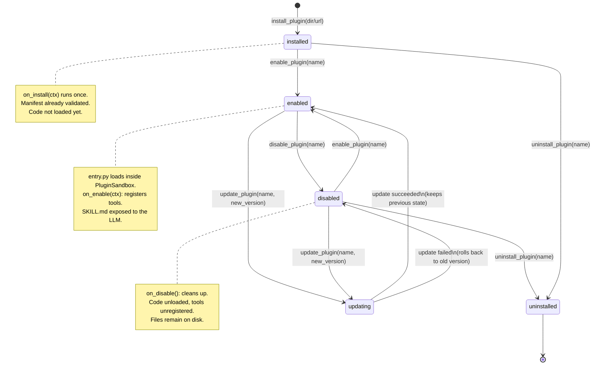

# The Unified Plugin System

> Design doc — unifying Boom's **skills** and **plugins** into a single architecture.
> Stdlib only.

## 1. The problem

Today Boom has two separate, unrelated extension systems:

| | **Skills** (`skill_loader.py`, `skills_hub.py`) | **Plugins** (`plugin_registry.py`, 41 lines) |
|---|---|---|
| Unit | Directory containing `SKILL.md` | Directory containing `plugin.json` + `entry.py` |
| Nature | Markdown instructions for the LLM to read | Real Python code that runs inside the agent |
| Loading | Lazy-loaded via `list_skills` / `view_skill` / `install_skill` | `scan_and_load()` via importlib, all at once |
| Privileges | Runs no code → needs no privileges | Full agent process privileges, unrestricted |
| Lifecycle | None | None (one-shot `register(ctx)`) |
| Manifest | Freeform YAML frontmatter in `SKILL.md` | Bare-bones `plugin.json` (`name`, `entry` only) |

Consequences: to add an extension, a dev must pick one of two systems; there is no way for an "LLM guidance skill" to ship with "executable code"; and plugins run with the agent's full privileges — a security risk.

## 2. The new architecture: one unified system

Each plugin is **a directory** with up to 3 components:

```
my-plugin/
├── plugin.json      # (REQUIRED) manifest: name, version, permissions, entry point
├── entry.py         # (REQUIRED for code plugins) Python code, lifecycle hooks
└── SKILL.md         # (OPTIONAL) guidance for the LLM: when to use it, how to use it
```

Three coordinating modules (stdlib only):

```
agent/src/extensibility/
├── __init__.py        # exports PluginManager / PluginManifest / PluginSandbox (try/except)
├── manifest.py        # PluginManifest: reads + validates plugin.json
├── lifecycle.py       # PluginManager: install / enable / disable / uninstall / update
├── sandbox.py         # PluginSandbox: executes plugin code under declared permissions
├── skill_loader.py    # (legacy, kept) — reads a plugin's SKILL.md as a "skill"
└── skills_hub.py      # (legacy, kept) — list_skills/view_skill tools now look at plugin/
```

How it works:

1. **PluginManifest** reads `plugin.json` and validates the schema (required fields, semver version, valid permissions). An invalid manifest is rejected at install time.
2. **PluginManager** manages lifecycle and state (stored in SQLite or JSON at `~/.boom/plugins/state.json`): only plugins in the `enabled` state are loaded.
3. **PluginSandbox** loads `entry.py` with importlib **inside an environment restricted by the declared permissions** (see section 6), then calls the lifecycle hooks:
   `on_install` → `on_enable` → (run) → `on_disable` → `on_uninstall`.
4. `SKILL.md` (when present) is read by `skill_loader` like any ordinary skill, so the LLM knows when to call the tools a plugin registers — a bridge between "guidance" and "real code".

### 2.1. `plugin.json` schema

```json
{
  "name": "hello-plugin",
  "version": "1.0.0",
  "description": "Sample hello plugin",
  "author": "Boom",
  "license": "MIT",
  "homepage": "https://example.com",
  "entry": "entry.py",
  "skill": "SKILL.md",
  "permissions": [],
  "boom_api": ">=0.1",
  "tags": ["demo"]
}
```

Required fields: `name`, `version`, `description`, `author`, `entry`, `permissions`.
Everything else is optional with sensible defaults
(`entry` defaults to `"entry.py"`, `skill` defaults to `"SKILL.md"` when the file exists).

`name` convention: lowercase, hyphenated, e.g. `gmail-tools`, `price-watcher`.
`version` follows semver `MAJOR.MINOR.PATCH`.

### 2.2. Lifecycle hooks in `entry.py`

```python
def on_install(ctx):   # runs once at install time
def on_enable(ctx):    # runs each time the plugin is enabled (register tools here)
def on_disable():      # runs when the plugin is disabled (clean up here)
def on_uninstall():    # runs once at uninstall time
def on_update(ctx, old_version):  # runs when the version is updated
```

Backward compatible: old plugins with only `register(ctx)` still work — the manager wraps `register` as `on_enable`.

`ctx` (PluginContext) provides: `register_tool(name, func, description, schema)`,
`unregister_tool(name)`, `get_config(key)`, `log(...)`, and `skill_text` (the contents of
`SKILL.md` when present).

## 3. Comparison table

| Criterion | Skills (old) | Plugins (old) | **New unified system** |
|---|---|---|---|
| Distribution unit | Directory + `SKILL.md` | Directory + `plugin.json` + `entry.py` | Directory + `plugin.json` + `entry.py` + `SKILL.md` (optional) |
| Runs code | No | Yes (full privileges) | Yes, **limited by permissions** |
| Guidance for the LLM | Yes (`SKILL.md`) | No | Yes — `SKILL.md` ships with the plugin |
| Manifest | Freeform YAML frontmatter | Bare-bones `plugin.json` | Full-schema `plugin.json`, strictly validated |
| Lifecycle | None | Only one-shot `register()` | `install → enable → disable → uninstall` + `update` |
| Runtime on/off | No (always "present" for reading) | No (load = run) | Yes — state persisted |
| Permissions | N/A | No concept | `network`, `filesystem`, `shell`, `env` (section 6) |
| Runtime isolation | N/A | None | PluginSandbox by permission |
| Agent tools | `list_skills`, `view_skill`, `install_skill` | None | Keep the 3 tools + add `enable_plugin`, `disable_plugin`, `uninstall_plugin`, `update_plugin`, `list_plugins` |
| Backward compatibility | — | — | Reads both legacy formats (section 4) |

## 4. Migration path

### 4.1. Old skills (`SKILL.md` only) → plugin

An old skill has no code, so wrap it as a "guidance-only" plugin:

1. Keep the skill directory and its `SKILL.md`.
2. Add a minimal `plugin.json`:
   ```json
   {
     "name": "old-skill-name",
     "version": "1.0.0",
     "description": "<copy from frontmatter description>",
     "author": "<previous author, or 'Boom'>",
     "entry": "entry.py",
     "permissions": []
   }
   ```
3. Add an empty `entry.py` (hooks only, no tools registered):
   ```python
   """Skill <name> wrapped as a plugin — SKILL.md only, no code."""

   def on_enable(ctx):
       # Registers no tools; skill_loader still reads SKILL.md for the LLM.
       return None

   def on_disable():
       return None
   ```
4. Copy the directory into `plugins/` (or run `install_plugin --from-skill <dir>` —
   the manager generates the two files above).
5. Old `view_skill` / `list_skills` still see the content because the manager exposes `SKILL.md`
   through the same `SkillLoader` interface.

No data loss, no renames: the `name` in `plugin.json` should match the old skill
directory name so old `view_skill` tool calls keep working.

### 4.2. Old plugins (`plugin.json` + `entry.py`) → full manifest

1. Fill in any missing required fields in `plugin.json`:
   `description`, `author`, `permissions` (defaults to `[]` if the plugin needs nothing,
   but **listing exactly** what the code really uses is recommended — see section 6).
2. Rename the `register(ctx)` hook → `on_enable(ctx)` (or keep it — the manager wraps it,
   but renaming makes the lifecycle clearer). Add `on_disable()` to clean up resources
   the old `register` opened (threads, file handles, connections).
3. (Recommended) add a `SKILL.md` telling the LLM when to call the plugin's tools.
4. Run `validate_plugin <dir>` — PluginManifest reports exactly which fields are missing.

### 4.3. Safe rollout order

1. Ship the new `manifest.py` + `lifecycle.py` + `sandbox.py`, keep the 2 old modules.
2. Run the migration script for `skills/*` → generate template `plugin.json` + `entry.py`.
3. Enable "unified mode" once all old plugins have full manifests.
4. Delete the old `plugin_registry.py` when no plugin uses a bare `register()` anymore.
## 5. Lifecycle diagram



Each transition in detail:

| Transition | Trigger | Actions | Rollback on failure |
|---|---|---|---|
| `install` | `install_plugin(path/url)` | validate manifest → copy into `plugins/<name>/` → write `installed` state → call `on_install` | delete the copied directory |
| `enable` | `enable_plugin(name)` | sandbox loads `entry.py` → call `on_enable(ctx)` → register tools → `enabled` state | call `on_disable` if partially run, keep old state |
| `disable` | `disable_plugin(name)` | call `on_disable()` → unregister tools from registry → unload module → `disabled` state | log a warning, keep `enabled` state if cleanup failed |
| `uninstall` | `uninstall_plugin(name)` | (disable first if enabled) → call `on_uninstall()` → delete directory → delete state | no rollback (already deleted) — backup to `~/.boom/plugins/.trash/` for 7 days |
| `update` | `update_plugin(name, src)` | back up old version → install over it → call `on_update(ctx, old_version)` → keep previous enabled/disabled state | restore backup, re-invoke the old version's hooks |

## 6. Permissions model

`permissions` in `plugin.json` is a **list of strings**. A plugin **has no permissions by default** (`[]`): it can only do pure computation (algorithms, string formatting, data validation) and call `ctx` APIs (register tools, log, read its own config).

The sandbox enforces limits on what plugin code can touch; anything not declared is blocked and raises `PermissionError` with a clear message.

| Permission | Syntax | Allows | Example use |
|---|---|---|---|
| **network** | `"network"` or `"network:example.com"` | Open outbound HTTP(S) connections. The bare form `"network"` = all hosts (avoid); the `"network:<host>"` form = that host only. Without it: all `socket`/`http.client`/`urllib`/`httpx`/`requests` use inside the plugin is blocked. | Price lookup, RSS reading, API calls |
| **filesystem** | `"filesystem:read"` / `"filesystem:write"` / `"filesystem:read:/allowed/path"` | Read/write files. Default (unscoped): only within the plugin's own directory. `read` does not grant `write` and vice versa. Any access outside the scope → blocked. | Caching data, reading the plugin's own config files |
| **shell** | `"shell"` or `"shell:ffmpeg,yt-dlp"` | Spawn child processes (`subprocess`, `os.system`). The listed form = only those binaries. Without it: `subprocess`/`os.popen`/`os.system` are blocked. | Calling `ffmpeg` to cut video, `tesseract` for OCR |
| **env** | `"env"` or `"env:API_KEY,TOKEN"` | Read environment variables (`os.environ`). The bare form = all variables; the listed form = only those. Without it: `os.environ` returns an empty dict for the plugin. | Reading a user-configured API key |

General rules:

- **Declare the minimum**: only request what the code needs. Reviewers reject plugins requesting `"network"` + `"shell"` + `"filesystem:write"` without justification.
- **Narrowest scope wins**: `"network:api.example.com"` beats `"network"`;
  `"filesystem:read:~/.boom/data"` beats `"filesystem:read"`.
- **Permissions are a ceiling, not a floor**: even with `"filesystem:write"`, a plugin
  may not overwrite other plugins' files or Boom system files
  (`agent/src/`, `~/.boom/config.json`, ...) — the sandbox blocks those via allowlist.
- **User approves at install**: `install_plugin` prints the permissions table and asks for
  confirmation (or a `--yes` flag for scripts). Any update that **adds new permissions**
  must be re-approved.
- **No "request more permissions at runtime"**: to gain a permission → update the manifest
  → the user re-approves. This avoids prompt fatigue and confused-deputy problems.

Example manifest for a plugin that calls a weather API and caches files:

```json
{
  "name": "weather-vn",
  "version": "1.2.0",
  "description": "Vietnam weather forecast",
  "author": "Boom",
  "entry": "entry.py",
  "permissions": [
    "network:api.open-meteo.com",
    "filesystem:write"
  ]
}
```

## 7. Full plugin example

The `examples/hello-plugin/` plugin demonstrates the minimal structure (0 permissions).
Below is a fuller example — a coin-price alert plugin using all 4 permission groups:

`plugin.json`:
```json
{
  "name": "price-watcher",
  "version": "1.0.0",
  "description": "Track coin prices and alert when a threshold is hit",
  "author": "Boom",
  "license": "MIT",
  "entry": "entry.py",
  "skill": "SKILL.md",
  "permissions": [
    "network:api.coingecko.com",
    "filesystem:write",
    "env:PRICE_WATCHER_TG_TOKEN"
  ],
  "tags": ["finance", "alert"]
}
```

`entry.py`:
```python
"""Price watcher — full-permission plugin example."""

import json
import urllib.request
from pathlib import Path

_STATE = None  # Path to the state file, set in on_enable


def _get(ctx, coin: str) -> float:
    url = f"https://api.coingecko.com/api/v3/simple/price?ids={coin}&vs_currencies=usd"
    with urllib.request.urlopen(url, timeout=15) as resp:  # needs network permission
        data = json.loads(resp.read().decode("utf-8"))
    return float(data[coin]["usd"])


def on_enable(ctx):
    global _STATE
    plugin_dir = Path(__file__).resolve().parent
    _STATE = plugin_dir / "state.json"          # needs filesystem:write

    def price_alert(coin: str, target: float) -> str:
        """Check the current price of a coin against a target threshold (USD)."""
        current = _get(ctx, coin)
        hit = current >= target
        _STATE.write_text(json.dumps({"coin": coin, "last": current}))
        status = "THRESHOLD HIT" if hit else "not reached"
        return f"{coin}: ${current:,.2f} — {status} (threshold ${target:,.2f})"

    ctx.register_tool(
        "price_alert",
        price_alert,
        description="Check a coin's price against a threshold. Use when the user asks about coin prices.",
        schema={"coin": "string", "target": "number"},
    )
    ctx.log("price-watcher enabled")


def on_disable():
    global _STATE
    _STATE = None  # don't hold the file handle after disabling


def on_update(ctx, old_version):
    ctx.log(f"price-watcher updated {old_version} -> 1.0.0")
```

`SKILL.md`:
```markdown
# price-watcher

Track coin prices via CoinGecko.

## When to use
- The user asks "what's the BTC price", "alert me when ETH hits 5000", ...
- The user wants to save price thresholds for periodic checks.

## Tool
- `price_alert(coin, target)`: `coin` is a CoinGecko id (e.g. `bitcoin`),
  `target` is the USD threshold. Returns the current price + hit/not-hit status.
```

## 8. New agent tools

Keep `list_skills` / `view_skill` / `install_skill` (backward compatible, now reading
from plugins with `SKILL.md`), plus:

- `list_plugins()` — list plugins + version + state (installed/enabled/disabled)
- `enable_plugin(name)` / `disable_plugin(name)` — toggle at runtime
- `install_plugin(path_or_url, yes=False)` — validate manifest, print permissions table, wait for approval
- `uninstall_plugin(name, backup=True)` — uninstall, 7-day backup
- `update_plugin(name, src)` — update keeping the current state, rollback on failure
- `plugin_permissions(name)` — view a plugin's current permissions (for audits)

## 9. Risks and settled decisions

1. **Stdlib only**: no new dependencies for the core (sandbox is hand-written with importlib +
   builtins/sys.modules control, no RestrictedPython).
2. **No runtime permission hot-patching**: every permission change goes through a manifest
   update + user re-approval.
3. **A broken plugin must not crash the agent**: `on_enable` raising → the plugin stays
   `disabled`, the error is logged with a full traceback, the agent keeps running.
4. **Two-way backward compatibility**: reads old skills (auto-wrapped) and old plugins
   (`register()` → wrapped as `on_enable`).
5. **`__init__.py` uses try/except ImportError**: while the 4 modules were being built in
   parallel, the package still imported even if `lifecycle.py` / `manifest.py` / `sandbox.py`
   didn't exist yet; missing exports are `None` until the module lands.
